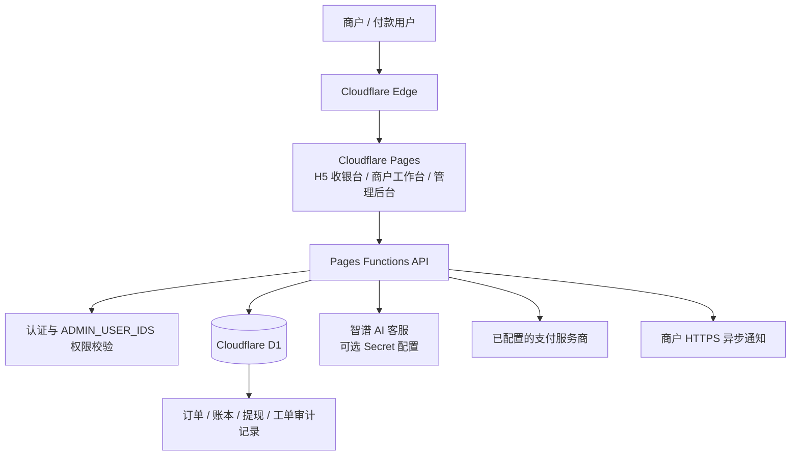

# 晴天支付（Qingtian Pay）- 基于 Cloudflare 生态的零门槛白牌聚合支付网关

<p align="center">
  
</p>

<p align="center">
  <a href="https://github.com/Zhouzhou198871/pay/actions"></a>
  <a href="LICENSE"></a>
  <a href="https://pages.cloudflare.com/"></a>
</p>

晴天支付是基于 Cloudflare Pages Functions 与 D1 构建的白牌支付网关项目，提供商户工作台、支付 API、订单管理、提现申请与客服工单等能力。生产功能、支付渠道及商户权限以实际部署配置、服务协议和审核结果为准。

## 架构概览



## 核心特性

- **Cloudflare Edge 与 D1 持久化**：边缘函数处理请求，D1 保存账户、订单、账本、提现及工单数据；通过组合索引和分页接口降低历史记录查询成本。
- **AI 智能客服**：支持配置智谱 API Key，在无人工客服在线时为常见接入问题提供自动答复；提现状态、权限审批等敏感事项应转人工处理。
- **多渠道提现工作流**：支持按已开放渠道提交提现申请、记录费用与收款信息、管理员审核及打款凭证登记。后台“登记打款”不等于自动执行银行转账或链上转账。
- **白牌 H5 收银台**：支持商户 API 创建订单及托管收银台体验；具体支付渠道受生产环境服务商配置和账户审核约束。
- **商户与管理员分权**：商户 API 权限需审核；管理接口由 `ADMIN_USER_IDS` 白名单保护。
- **可审计客服工单**：支持商户与管理员消息、权限申请、开发者合规承诺及受权限控制的附件查看。

## 技术栈

- Cloudflare Pages / Pages Functions
- Cloudflare D1（SQLite）
- Vite
- JavaScript / Web Crypto API
- GitHub Actions

## 本地开发

```bash
npm install
npm run dev
npm run check
npm test
npm run build
```

Pages Functions 本地开发需使用 Wrangler 绑定 D1。生产数据库迁移请按版本顺序审阅 `migrations/` 后执行，不要在正式环境随意删除交易或账本数据。

## 生产环境变量

在 Cloudflare Dashboard → Workers & Pages → `qingtian-pay` → Settings → Variables and Secrets 中配置。敏感值必须使用 Secret 类型，禁止提交到仓库或聊天记录。

| 变量 | 类型 | 用途 |
|---|---|---|
| `AUTH_SECRET` | Secret | 会话 / 验证相关密钥 |
| `ADMIN_USER_IDS` | Text | 管理员用户 ID 白名单，逗号分隔 |
| `RESEND_API_KEY` | Secret | 邮件发送 |
| `GITHUB_CLIENT_ID` | Text | GitHub OAuth 客户端 ID |
| `GITHUB_CLIENT_SECRET` | Secret | GitHub OAuth 客户端密钥 |
| `TURNSTILE_SITE_KEY` | Text | Turnstile 公钥 |
| `TURNSTILE_SECRET_KEY` | Secret | Turnstile 密钥 |
| `ZHIPU_API_KEY` | Secret | 智谱 AI 客服密钥（可选） |
| `PUBLIC_BASE_URL` | Text | 对外服务根地址，例如 `https://pay.example.com` |
| `NZZF_PID` | Text | 已签约支付服务商商户编号 |
| `NZZF_MERCHANT_PRIVATE_KEY` | Secret | 支付服务商商户私钥 |
| `NZZF_PLATFORM_PUBLIC_KEY` | Text | 支付服务商验签公钥 |
| `NZZF_USDT_CNY_RATE` | Text | 折算汇率 |
| `NZZF_FEE_RATE_BPS` | Text | 费率基点 |
| `WITHDRAW_USDT_CNY_RATE` | Text | 提现折算汇率 |

支付服务商参数、结算参数与费率必须依据真实签约合同及渠道要求配置。更换自定义域名或反向代理域名时，更新 `PUBLIC_BASE_URL`，并同步校验支付回调白名单、OAuth 回调、Cookie 安全属性及 DNS / TLS 配置。

## 管理后台

- 管理入口：`/admin.html`
- 管理 API：`/api/admin/*`
- 仅当前登录用户 ID 命中 `ADMIN_USER_IDS` 才可访问管理 API。
- 提现审核中的“登记打款”仅登记已完成的外部打款凭证，不会自动向收款人转账。
- 商户 API 权限由客服工单审核流程开通。

## API 文档

- [开发者接入指南](docs/DEVELOPER_GUIDE.md)
- [API 接口参考](docs/API_REFERENCE.md)
- [Firebase / Firestore 接入规范](docs/FIREBASE_FIRESTORE_GUIDE.md)

## 安全与合规免责声明

本项目仅供合法合规的支付技术集成与业务管理使用。**严禁将本平台用于洗钱、诈骗、赌博、制裁规避、非法集资、侵犯个人信息或其他违法违规活动。** 商户必须确保业务及资金来源合法，并遵守适用法律法规、支付机构规则、反洗钱和数据保护要求。平台可依据适用法律及风险规则要求补充核验资料、限制服务并依法向有权机关报告。

本项目代码或技术能力不构成支付牌照、资金托管资格、银行结算能力、交易成功率、资金安全或收益保证。上线运营前，运营主体必须自行完成必要的法律、牌照、支付渠道、税务、隐私与信息安全审查，并签署真实有效的服务协议。

## License

本仓库按 MIT License 发布，详见 [LICENSE](LICENSE)。第三方服务、商标、支付渠道及依赖组件仍受各自条款约束。
