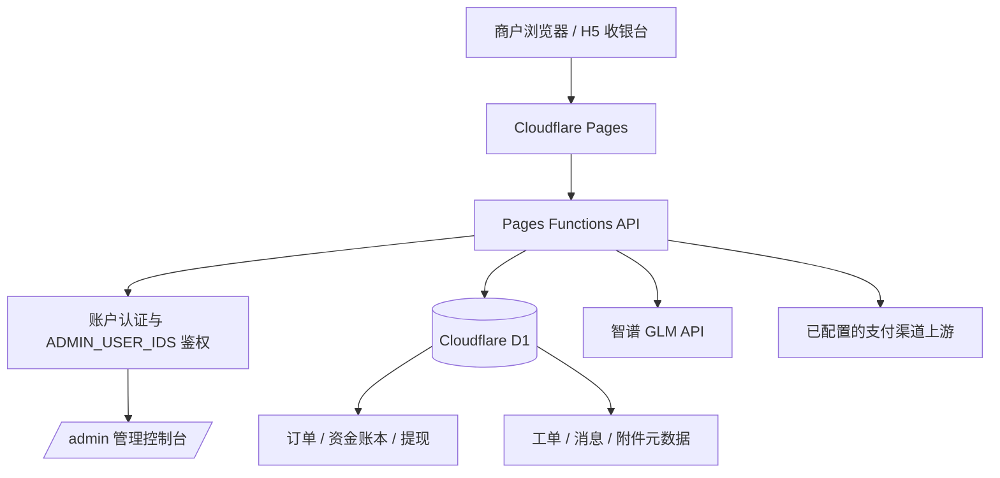

# 晴天支付（Qingtian Pay）- 基于 Cloudflare 生态的零门槛白牌聚合支付网关

[](https://github.com/Zhouzhou198871/pay/actions/workflows/ci.yml)
[](LICENSE)
[](https://pages.cloudflare.com/)

面向合规经营商户的支付接入与交易管理平台，采用 Vite、Cloudflare Pages Functions 与 Cloudflare D1 构建。生产站点：**https://pay.lynli.me**

## 核心特性

- **Cloudflare D1 持久化**：账户、商户、订单、资金账本、提现和客服工单统一存储；关键查询配备复合索引与分页，避免一次性加载完整历史。
- **AI 智能客服**：可选接入智谱 GLM（glm-4-flash），为接入流程、费率和 API 基础问题提供自动答复；提现、审批等敏感事项转人工。
- **多渠道提现申请**：支持 USDT 提现资料及微信/支付宝收款码资料提交；后台审核、状态记录和外部打款凭证留档。
- **白牌 H5 收银台**：商户可通过标准化接口和 H5 支付页接入已开放的支付渠道。
- **商户 API 权限审批**：网站、机器人和 APP 接入申请、合规承诺、附件核验、管理员审批及审计记录。
- **受限管理后台**：`/admin` 及管理 API 均由服务端 `ADMIN_USER_IDS` 白名单鉴权。

## 架构概览



## 技术栈

| 层 | 技术 |
|---|---|
| Web 前端 | Vite、原生 JavaScript、响应式 CSS |
| API 与业务逻辑 | Cloudflare Pages Functions |
| 数据持久化 | Cloudflare D1（SQLite） |
| AI 客服 | 智谱 GLM API（可选） |
| 部署 | Cloudflare Pages + GitHub Actions |

## 本地开发

```bash
npm install
npm run check
npm test
npm run build
npm run dev
```

Pages Functions 在本地开发时需要配置 D1 binding 与本地环境变量。不要将密钥写入仓库或提交到 Git。

## Cloudflare 环境变量

在 Cloudflare Pages 项目 `qingtian-pay` 的 Production 环境中按实际启用功能配置：

| 变量 | 类型 | 用途 |
|---|---|---|
| `AUTH_SECRET` | Secret | 认证签名与验证码保护 |
| `RESEND_API_KEY` | Secret | 事务邮件 |
| `MAIL_FROM` | Text | 邮件发件人 |
| `ADMIN_USER_IDS` | Text | 管理员用户 ID 白名单，逗号分隔 |
| `PUBLIC_BASE_URL` | Text | 对外规范域名，用于支付回调与通知 URL；自定义域名/反代上线时同步更新 |
| `ZHIPU_API_KEY` | Secret | 智谱 GLM 客服调用密钥 |
| `NZZF_PID` | Text | 上游支付渠道商户编号 |
| `NZZF_MERCHANT_PRIVATE_KEY` | Secret | 上游商户私钥 |
| `NZZF_PLATFORM_PUBLIC_KEY` | Text | 上游平台公钥 |
| `NZZF_USDT_CNY_RATE` | Text | 上游结算汇率 |
| `NZZF_FEE_RATE_BPS` | Text | 渠道手续费基点 |
| `NZZF_API_URL` | Text | 上游 API 地址；默认值由服务端实现提供 |
| `WITHDRAW_USDT_CNY_RATE` | Text | 法币提现折算汇率 |

仅在 Cloudflare Dashboard 的 Secret 类型字段中录入密钥。若凭据曾粘贴到聊天、日志或代码仓库，应先撤销并轮换。

## API 地址与自定义域名

浏览器端 API 使用同源相对路径（例如 `/api/merchant/orders`），不把生产域名写死在前端代码中。绑定自定义域名或配置反向代理时，将页面流量与 `/api/*` 一并转发到同一 Pages 项目即可；无需为了更换站点域名逐个修改 API URL。支付上游地址等服务端外部地址通过对应环境变量管理。

## 管理后台

访问 `/admin`。服务端会使用当前登录会话并校验 `ADMIN_USER_IDS`；未登录或不在白名单中的账户不能读取后台数据或调用管理 API。

后台提供数据概览、商户状态管理、订单查询、提现审核及客服工单审批。提现审核中的“登记已打款”用于记录已在外部渠道完成的转账凭证，**不会自动向银行、微信或支付宝发起资金转账**。

## 合规与免责声明

本项目是软件系统与技术接入工具，不代表任何支付牌照、资金托管资质、银行账户或第三方支付渠道授权。实际经营者必须自行确认其经营主体、业务地区、支付服务模式、数据处理活动及合作渠道符合适用法律法规和监管要求，并在上线前取得所需许可、备案和合作方授权。

**严禁将本平台用于洗钱、诈骗、赌博、非法集资、制裁规避、侵害消费者权益或其他违法违规用途。** 平台运营方应实施商户尽职调查、交易监测、风险处置、记录留存及依法报告机制。任何费率、结算、提现和风控说明均以正式商户协议、已开通渠道规则及实际审核结果为准；不得将软件功能描述为资金绝对安全、必然到账或保证赔付。

## License

本项目按 [MIT License](LICENSE) 授权。
